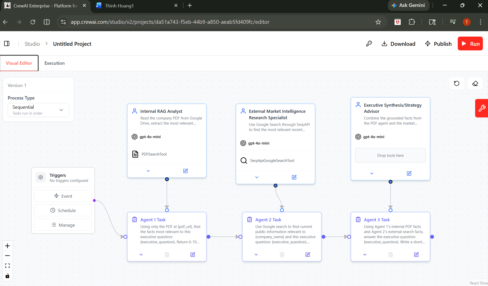

# AI Market Intelligence | Python Research Workflow & CrewAI

## Overview

A Python-based market intelligence research project designed to analyze company documents and organize relevant evidence for business research.

The project includes a tested offline research workflow and an experimental multi-agent AI implementation using CrewAI.

## Workflow Diagram



## Technologies

- Python
- Document analysis and text retrieval
- PDF processing with pypdf
- CrewAI (experimental integration)
- SerpAPI (optional web research)
- Pytest for automated testing

## Features

### Offline Research Workflow — Tested

- Reads company documents from PDF and text files.
- Retrieves evidence related to a business research question.
- Generates structured Markdown reports with source references.
- Supports optional external research when configured.
- Includes automated tests.

### Multi-Agent AI — Experimental

The repository also contains a CrewAI workflow designed to coordinate multiple research agents.

This implementation requires an LLM/API configuration and has not yet been validated through a live execution.

## Example Results

Tested using a fictional company scenario, Example Retail.

The workflow successfully generated a Markdown evidence report documenting revenue growth, shipping costs, and supplier delays.

[View Example Research Report](outputs/example-retail-report.md)

Note: The example data is fictional and does not represent real company financial results.

## How to Run

Install dependencies:

```bash
python -m pip install -r requirements.txt
```

Run the tested offline workflow:

```bash
python main.py --company "Example Retail" --question "What are the main business risks and growth opportunities?" --data-dir data --mode offline
```

Run automated tests:

```bash
python -m pip install pytest
python -m pytest tests -v
```

## Validation

- Offline research workflow: Successfully executed
- Example Markdown report: Generated
- Automated tests: 2 passed
- Live CrewAI/LLM execution: Not yet verified

## Project Structure

- `main.py` — Main entry point
- `research.py` — Document retrieval and reporting
- `agents_workflow.py` — Experimental CrewAI workflow
- `data/` — Sample company documents
- `outputs/` — Example research report
- `tests/` — Automated tests
- `requirements.txt` — Core dependencies
- `requirements-ai.txt` — Optional AI dependencies

## Future Improvements

- Validate live CrewAI execution with a configured LLM
- Improve semantic retrieval relevance
- Evaluate report quality using real public company documents
- Add a user-facing interface

## Disclaimer

This project is a portfolio demonstration. Research outputs should be independently verified before being used for business decisions.
